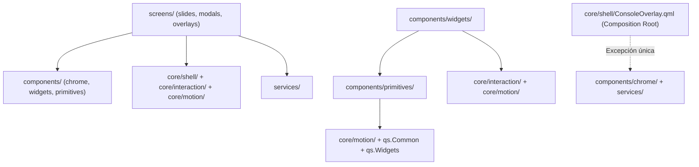

# DuxConsole — Arquitectura por Archivo (Problema → Solución)

Este documento detalla qué problema resuelve cada archivo de `DuxConsole/`, cómo lo soluciona, qué dibuja (si es visual) y cómo se mantienen desacopladas las dependencias.

---

## 1. Dirección de Dependencias

- **Regla estricta**: `core/` nunca importa `components/`, `screens/` ni `services/`, con la única excepción del *Composition Root* en `core/shell/ConsoleOverlay.qml`.

---

## 2. Raíz del Plugin y Configuración Data-Driven

### `plugin.json`
- **Problema**: DMS necesita descubrir el tipo de plugin, su punto de entrada y versión mínima compatible sin ejecutar QML.
- **Solución**: Declara `id: "duxConsole"`, `type: "daemon"` y `component: "./ConsoleDaemon.qml"`.

### `ConsoleDaemon.qml`
- **Problema**: El overlay debe permanecer disponible en segundo plano y abrirse/cerrarse mediante atajos de teclado o comandos externos.
- **Solución**: Instancia `PluginComponent`, expone un `IpcHandler` (`target: "duxConsole"`) con `toggle()`, `open()`, `close()`, y monta `ConsoleOverlay` enlazado a `overlayOpen`. No dibuja UI propia.

### `inputconfig.json`
- **Problema**: Hardcodear teclas o códigos de mando (`BTN_SOUTH`, `Return`) rompe la portabilidad entre teclado, Xbox, PlayStation y distintos usuarios.
- **Solución**: Mapea códigos crudos de `keyboard` y `gamepad` a acciones semánticas (`I.*`) y define `gestures` (`repeatInitialMs`, `repeatIntervalMs`, `repeatable`, `holds`, `chords`).

### `iconsconfig.json`
- **Problema**: Cada mando tiene iconos y variantes distintas (`filled`/`outline`, `mono`/`colored`) y las rutas no deben vivir dentro del código QML.
- **Solución**: Mapea códigos crudos por dispositivo (`keyboard`, `xbox`, `playstation`, `switch`, `steamdeck`) hacia sus SVGs en `assets/InputIcons/` con variantes `mono` y `colored` opcional.

### `uiconfig.json`
- **Problema**: Ajustar idioma, animaciones, opacidad o modo visual sin recompilar ni editar QML.
- **Solución**: Centraliza `language`, `animations` (`enabled`, `speed`, `fadeInMs`, `fadeOutMs`), `theme` (`mode`, `accentSource`, `customAccent`, `skewAngle`, `scrimOpacity`) e `icons` (`colorMode`, `style`, `customColor`, `showBackdrop`). Las superficies de componentes son sólidas; solo `Bg.qml` controla transparencia global.

### `locales/es.json` y `locales/en.json`
- **Problema**: Textos literales en QML impiden cambiar de idioma en caliente.
- **Solución**: Diccionarios JSON organizados por sección (`nav.*`, `demo.*`, `hints.*`, `error.*`). Para agregar un idioma basta crear `locales/<code>.json` y ajustar `"language"` en `uiconfig.json`.

---

## 3. `core/shell/` — Infraestructura del Overlay

### `core/shell/ConsoleOverlay.qml`
- **Problema**: Se necesita una ventana Wayland fullscreen que capture teclado de forma exclusiva al abrirse, coordine entrada, capas, foco, estilos y reporte errores si una pantalla falla.
- **Solución**: Actúa como *Composition Root* (`PanelWindow` en `WlrLayer.Overlay`). Instancia `ScreenRegistry`, `LayerManager`, `NavigationManager`, `I18n`, `StyleTokens`, `MotionTokens`, `IconsPadManager`, `DconsoleBridge`, `WindowManager`, `WindowIconProvider` e `InputManager`. Inyecta los servicios de ventana a través de `SlideManager`; en `onActiveChanged` asegura foco al abrir (`ensureFocus`) y limpia estado al cerrar (`resetState`, `reset`).
- **Qué dibuja**: Monta `Bg`, el contenido de `SlideManager`, `FocusRing` y `ErrorBanner`.

### `core/shell/InputManager.qml`
- **Problema**: Los eventos llegan desde fuentes distintas (teclado Qt hoy, socket `dconsole` mañana) y requieren repetición controlada, holds (`I.Guide`) y acordes (`I.Guide + ...`).
- **Solución**: Carga `../../inputconfig.json` con `FileView` (`watchChanges: true`), normaliza pulsaciones/liberaciones en `handleRawPress`/`handleRawRelease`, actualiza `activeDevice` y emite la señal única `triggered(action, payload)`.

### `core/shell/IconsPadManager.qml`
- **Problema**: La UI pide glifos por acción semántica (`"I.Accept"`), no por tecla o botón físico, y debe adaptarse al dispositivo activo y modo de color.
- **Solución**: Lee `../../iconsconfig.json` con `FileView`, cruza `inputManager.config` con `StyleTokens` (`dms`/`colored`/`custom`, `filled`/`outline`, migración `"native"` → `"colored"`) y expone `resolve(action)`.

### `core/shell/I18n.qml`
- **Problema**: Las pantallas necesitan textos traducidos con recarga en caliente al editar `uiconfig.json` o `locales/*.json`.
- **Solución**: Lee `language` de `uiconfig.json` (soporta `"auto"`), carga `locales/<lang>.json` con `FileView` (`watchChanges: true`) y expone `t(key, fallback)`.

### `core/shell/StyleTokens.qml`
- **Problema**: Los temas claros de DMS lavan el fondo si se usa `Theme.surface` sin control, y los componentes necesitan roles semánticos consistentes para `hybrid`, `dark` y `light`.
- **Solución**: Carga `uiconfig.json`, resuelve `accentColor` (Matugen o `customAccent`), `scrimColor(mult)`, `surfaceColor(role)`, `onSurfaceColor(role)` y `borderColor(role)` para `"chrome"` y `"card"`.

### `core/shell/ScreenRegistry.qml`
- **Problema**: `SlideManager` y `TopBar` necesitan conocer las pantallas disponibles sin acoplar rutas ni títulos hardcodeados.
- **Solución**: Expone el arreglo `screens` con `{ id, labelKey, icon, source }` apuntando a `../../screens/slides/...`.

### `core/shell/SlideManager.qml`
- **Problema**: Cargar slides dinámicamente, inyectarles los gestores compartidos y capturar fallos de carga QML sin dejar pantalla en blanco.
- **Solución**: Usa un `Loader` enlazado a `ScreenRegistry.screens[currentIndex]`, inyecta `inputManager`, `layerManager`, `navigationManager`, `iconsPadManager`, `i18n`, `styleTokens`, `motionTokens`, `windowManager`, `windowIconProvider`, `registry` y `currentSlideIndex`. Si `status === Loader.Error`, captura `errorString()` vía `Qt.createComponent()` para `ErrorBanner`.

### `core/shell/ScreenBase.qml`
- **Problema**: Evitar que cada slide repita márgenes, propiedades de servicios inyectados y helpers de traducción.
- **Solución**: `Item` base (`anchors.fill: parent`) con contenedor interior con márgenes `Theme.spacingXL`, propiedades inyectadas (incluye los adaptadores de ventana) y helper `tr(key, fallback)`.

---

## 4. `core/interaction/` — Capas, Foco y Navegación

### `core/interaction/LayerManager.qml`
- **Problema**: Al abrir un modal o wheel sobre el dashboard, el foco de la pantalla inferior no debe perderse ni responder a eventos.
- **Solución**: Mantiene la pila de capas (`stack`, `topLayer`), guarda el identificador de la `FocusZone` activa en `focusMemory` al hacer `push()` y expone `setActiveZone()`, `focusZone()` y `rememberedZoneRef()`.

### `core/interaction/NavigationManager.qml`
- **Problema**: Si múltiples gestores seleccionan foco en paralelo, se producen carreras entre `defaultFocus` y el orden de registro; además las pantallas no deberían cablear manualmente cada `navUp`/`navDown` ni duplicar lógica de hints.
- **Solución**: Es la **autoridad única** de registro (`registerZone`/`unregisterZone`), selección inicial (`ensureFocus`: memoria → `defaultFocus` → arriba-izquierda), navegación espacial por cono direccional e `_intervalGap` (`move`), validación de capacidades (`subItemCount > 0` para LT/RT, `expandable` para `I.Select`) y cálculo de `activeHints`.

### `core/interaction/FocusZone.qml`
- **Problema**: Las secciones interactivas necesitan declarar sus capacidades y bloquearse automáticamente cuando están debajo de un modal.
- **Solución**: `Item` que envuelve una región navegable, calcula `inert` (`!layerManager.isLayerActive(layerName)`), guarda `currentSubIndex` para `LT`/`RT`, declara `defaultFocus`, `expandable`, `showFocusRing`, `actionHints` y emite `activated`, `secondaryTriggered`, `expandRequested` y `subItemCycled`.

---

## 5. `core/motion/` y `services/`

### `core/motion/MotionTokens.qml`
- **Problema**: Duraciones hardcodeadas impiden desactivar animaciones o ajustar su velocidad globalmente.
- **Solución**: Lee `uiconfig.json` con `FileView` y expone `durationFast`, `durationNormal`, `durationMorph`, `fadeInDuration`, `fadeOutDuration` (en `0` si `animations.enabled === false`) y curvas estándar.

### `services/DconsoleBridge.qml`
- **Problema**: Quickshell necesita recibir eventos de gamepad del daemon Go `dconsole` y notificarle si el overlay está abierto para activar el fail-safe.
- **Solución**: Cliente `Quickshell.Io.Socket` conectado a `$XDG_RUNTIME_DIR/dconsole.sock` con reconexión cada `2000 ms`, `SplitParser` NDJSON hacia `InputManager` y envío de `{ type: "overlay", active }`.

### `services/WindowManager.qml`
- **Problema**: Las pantallas y widgets necesitan enumerar ventanas, workspaces y monitores reales de Niri y ejecutar acciones sobre una ventana por ID sin acoplar sockets ni comandos IPC en el QML visual.
- **Solución**: Conecta dos sockets a `$NIRI_SOCKET`: `eventSocket` suscrito a `"EventStream"` para actualización reactiva sin polling (`WindowsChanged`, `WindowOpenedOrChanged`, `WindowClosed`, `WindowFocusChanged`, `WorkspacesChanged`, `WorkspaceActivated`, `WindowLayoutsChanged`) y `cmdSocket` serializado para `Outputs` y `Action` (`FocusWindow`, `MoveWindowToMonitor`, `MoveWindowToWorkspace`, `FullscreenWindow`, `CloseWindow`). Incluye reconexión automática (`2000 ms`) y estado `unavailable` si no hay Niri. El servicio no expone PID ni termina procesos.

### `services/WindowIconProvider.qml`
- **Problema**: Niri IPC y Quickshell Wayland no exponen capturas de píxeles por ID de ventana sin screencasting PipeWire permanente.
- **Solución**: Servicio visual que resuelve iconos XDG vía `Quickshell.iconPath(appId, true)` con fallback localizado. Lo instancia `ConsoleOverlay.qml` y lo inyecta a través de `SlideManager` para no invertir dependencias desde `components/widgets/` hacia `services/`.

### `services/MediaService.qml` y `services/CavaService.qml`
- **Problema**: `MediaPlayerCard` y el reproductor expandido necesitan datos MPRIS reales, cambio entre reproductores, búsqueda por posición (`seek`) y espectro de audio sin mantener procesos pesados cuando el modal está cerrado.
- **Solución**: `MediaService.qml` envuelve `Quickshell.Services.Mpris` (`Mpris.players.values`), expone metadatos, capacidades (`canSeek`, `shuffleSupported`, `loopSupported`, `volumeSupported`), `matchesTrack()` para validar letras contra la pista actual y acciones de transporte. `CavaService.qml` ejecuta `/usr/bin/cava` en modo `raw` únicamente mientras `MediaPlayerModal` está abierto y en reproducción.

### `components/primitives/surfaces/SlantedGeometry.js`, `components/primitives/meters/MediaProgressBar.qml` y `components/widgets/MediaLyricsPanel.qml`
- **Problema**: Las superficies inclinadas necesitan márgenes seguros y máscaras consistentes sin duplicar cálculos de `shear` ni recortar bordes o letras.
- **Solución**: `SlantedGeometry.js` centraliza `horizontalShearOffset`, `safeHorizontalInset` y `effectiveSkewAngle`. `MediaProgressBar` encapsula la pista, relleno, thumb y tiempos inclinados. `MediaLyricsPanel` envuelve `LyricsOverlay` dentro de una máscara inclinada real con una excepción localizada y documentada al contrato recto de `SlantedSurface` (`contentSkewAngle`).

### `components/widgets/MediaPlayerCard.qml`, `MediaPlayerExpanded.qml` y `screens/modals/MediaPlayerModal.qml`
- **Problema**: Mostrar un mini reproductor compacto con letras sincronizadas cuando existan (y carátula por defecto si faltan, cargan o no corresponden a la pista) y un reproductor expandido ControlFriendly con `LT`/`RT` visibles, transporte con SVG centralizados en `iconsconfig.json` y opciones accesibles por D-Pad.
- **Solución**: `MediaPlayerCard` muestra carátula, metadatos y marquee de letra sincronizada (usando `MotionTokens`); con `X` empuja la capa `"media-player"` (`MediaPlayerModal` + `MediaPlayerExpanded`), donde `Select` alterna entre `MediaLyricsPanel` y carátula cuando hay letras válidas, `LT`/`RT` buscan `±10s` si `canSeek`, `LB`/`RB` cambian pista y `B` restaura el foco.

### `components/widgets/WindowCarousel.qml`, `MediaPlayerCard.qml` y `screens/slides/HomeScreen.qml`
- **Problema**: Se requiere un prototipo inicial de `Inicio` separado del laboratorio `TestScreen.qml`.
- **Solución**: `HomeScreen.qml` presenta tarjetas independientes para título, descripción y monitor de la ventana seleccionada, un `WindowCarousel` centrado abajo en modo `iconOnly` y `MediaPlayerCard` abajo a la derecha. El carrusel mantiene modo rico para otras pantallas, `selectedWindowId` estable y micro-navegación LT/RT; la tarjeta seleccionada recibe borde de foco más ancho sin dibujar un `FocusRing` sobre toda la zona.

### `components/widgets/WindowInfoCard.qml` y `WindowInfoCards.qml`
- **Problema**: La ventana seleccionada necesita separar título, descripción de aplicación/workspace y monitor para facilitar su lectura rápida.
- **Solución**: `WindowInfoCards` compone tres `WindowInfoCard` reutilizables con contenido localizado y distribución vertical para dar ancho a la descripción; el título usa una jerarquía tipográfica mayor y las superficies usan transparencia configurada en `uiconfig.json`.

### `components/chrome/ModalPanel.qml` y `components/primitives/text/StatusMessage.qml`
- **Problema**: Los modales necesitan una superficie reutilizable y mensajes de error consistentes sin dibujar `StyledRect`/`StyledText` inline.
- **Solución**: `ModalPanel` encapsula una tarjeta sólida con `StyleTokens`; `StatusMessage` usa el color semántico de error del tema.

### `components/primitives/text/DisplayTitle.qml`
- **Problema**: Las pantallas necesitan títulos prominentes sin construir `StyledText` inline.
- **Solución**: Encapsula tipografía de encabezado y color semántico de superficie para ensamblaje desde screens.

---

## 6. `components/` y `screens/`

### `components/chrome/Bg.qml`
- **Problema**: Un fondo opaco tapa el juego/escritorio; sin scrim oscuro, un tema claro vuelve ilegible el texto.
- **Solución**: **Dibuja** dos gradientes (horizontal y vertical) usando `StyleTokens.scrimColor()`, dejando visible la derecha/arriba del escritorio con contraste controlado.

### `components/chrome/TopBar.qml`
- **Problema**: Una barra continua horizontal tapa innecesariamente la parte superior y no coincide con la estética modular de cápsulas separadas.
- **Solución**: `Item` contenedor transparente (sin fondo común) montado una sola vez en `ConsoleOverlay.qml` que **dibuja** tres cápsulas sólidas y opacas físicamente separadas (`radius: height / 2`): **Brand** izquierda (círculo oscuro + `CircularProgressGlyph` Guide + `assets/dux-logo.svg` + `DUXSHELL`/`CONSOLE`), **Navigation** centrada (`InputGlyph` LB/RB fuera de la cápsula + píldora de acento interior sobre `ScreenRegistry` + `I18n`), y **Status** derecha (batería mando + `UPower` + `SystemClock` + `CircularProgressGlyph` Start + perfil).

### `components/chrome/FooterBar.qml` y `components/chrome/ActionHints.qml`
- **Problema**: Agrupar todos los hints en una sola barra o dentro de cada slide provoca reconstrucciones y falta de contraste sobre fondos claros.
- **Solución**: `FooterBar` se monta de forma persistente abajo a la derecha en `ConsoleOverlay.qml` y envuelve `ActionHints`, que **dibuja** cada hint como una tarjeta individual (`SlantedSurface` `role: "card"`) en `Flow` (`Qt.RightToLeft`) con superficie sólida/opaca de alto contraste como fallback cuando Wayland no ofrece blur por tarjeta.

### `components/primitives/glyphs/CircularProgressGlyph.qml`
- **Problema**: Los botones `Guide` y `Start` requieren un indicador circular de progreso reutilizable sin acoplarse a lógica de acciones.
- **Solución**: **Dibuja** un anillo anti-aliased vía `Canvas` con estados `idle`, `charging` y `completed`, `progress` `0.0..1.0` y duraciones desde `MotionTokens`.

### `components/chrome/ErrorBanner.qml`
- **Problema**: Si un slide falla al cargar en tiempo de ejecución, el overlay quedaría vacío sin explicar qué se rompió.
- **Solución**: **Dibuja** un panel de error de alto contraste (`z: 999`) con textos localizados vía `i18n` (`error.title`, `error.close_hint`), ruta del archivo fallido y mensaje de error.

### `components/primitives/surfaces/SlantedSurface.qml`
- **Problema**: Inclinar todo un `Item` deforma textos, iconos y cálculo de foco/hit-testing.
- **Solución**: **Dibuja** un `Rectangle` de fondo (`bgShape`) con `Matrix4x4` shear (`skewAngle`), borde por estado (`normal`, `focused`, `selected`, `disabled`) y mantiene `contentContainer` 100% recto; admite modo `borderOnly` para delinear imágenes sin taparlas.

### `components/primitives/surfaces/SlantedImage.qml`
- **Problema**: `clip: true` en QtQuick no recorta esquinas redondeadas ni paralelogramos sin deformar la imagen.
- **Solución**: **Dibuja** una `Image` recta enmascarada con `MultiEffect` (`maskEnabled: true`) contra un `SlantedSurface` estático (`visible: false; layer.enabled: true`), con soporte `fillMode`, gradiente inferior, fallback y borde de foco.

### `components/primitives/buttons/ActionButton.qml` y `FocusCard.qml`
- **Problema**: Evitar tarjetas o botones inline dentro de las pantallas.
- **Solución**: Extienden `SlantedSurface`; `ActionButton` **dibuja** un botón con `InputGlyph` opcional y etiqueta; `FocusCard` **dibuja** una tarjeta de carrusel con `title` y `subtitle`.

### `components/primitives/glyphs/InputGlyph.qml`
- **Problema**: Los SVGs de Kenney monocromáticos son blancos con recorte transparente y se volvían invisibles sobre fondos claros u oscuros sin badge.
- **Solución**: **Dibuja** un badge blanco (`#FFFFFF`) con SVG tintado por `MultiEffect` en modo `"dms"`/`"custom"` o SVG nativo en `"colored"`, y `<kbd>` como fallback.

### `components/primitives/text/SectionTitle.qml` y `TestText.qml`
- **Problema**: Estandarizar encabezados de sección y tarjetas de texto de prueba.
- **Solución**: **Dibujan** título + subtítulo (`SectionTitle`) o tarjeta de texto destacada (`TestText`) con tokens tipográficos de `Theme`.

### `components/widgets/CarouselView.qml`
- **Problema**: Un carrusel infinito con ítem central expandido, vecinos compactos y escalado responsivo sin duplicar lógica de foco.
- **Solución**: **Dibuja** un `PathView` circular controlado por `FocusZone.currentSubIndex`, con `MotionTokens` y `Binding` de `index`, `selected`, `focused` e `itemData` hacia el `delegate`.

### `screens/slides/TestScreen.qml`, `TestScreen2.qml` y `screens/modals/ItemOptionsModal.qml`
- **Problema**: Validar la arquitectura visual y los 3 niveles ControlFriendly sin hardcodear UI en pantallas.
- **Solución**: `TestScreen.qml` ensambla `TopBar`, `SectionTitle`, `ActionButton`s, `SlantedImage`, `CarouselView`, `ActionHints` e `ItemOptionsModal` (capa `"modal"`). `TestScreen2.qml` valida el cambio de slide (`LB`/`RB`).
