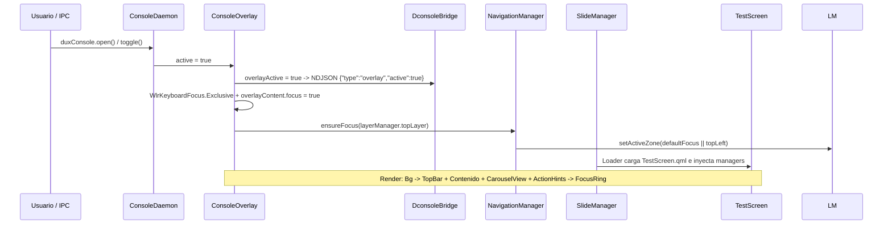
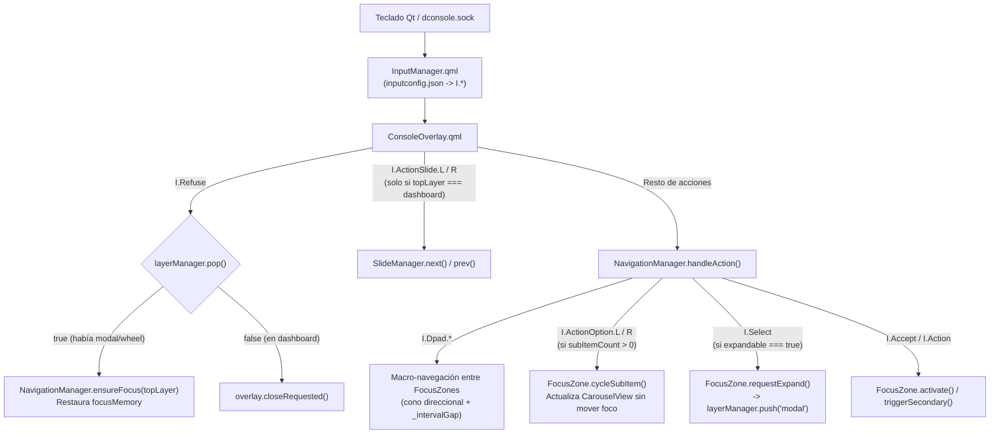

# DuxConsole — Flujo de Trabajo y Renderizado

Este documento describe el flujo exacto desde que el usuario abre `DuxConsole` hasta que navega, expande modales y cierra el overlay, indicando qué archivo participa y qué dibuja en pantalla.

---

## 1. Flujo al Abrir el Overlay

### Qué dibuja cada capa visual (de atrás hacia adelante)
1. **`Bg.qml`**: Scrim oscuro único en gradiente horizontal (mantiene visible el juego/escritorio en el lado derecho).
2. **`TopBar.qml`** *(chrome persistente)*: Barra superior fija fuera de `SlideManager` (izquierda: `CircularProgressGlyph` Guide + logo + `DuxShell/Console`; centro: `ScreenRegistry` + `LB/RB`; derecha: `CircularProgressGlyph` Start + baterías + `SystemClock` + perfil).
3. **`SlideManager.qml` → `TestScreen.qml`** *(anclado entre `topBar.bottom` y `footerBar.top`)*:
   - **`SectionTitle.qml` + `ActionButton.qml`**: Encabezados y botones inclinados con `InputGlyph`.
   - **`SlantedImage.qml`**: Vista previa con imagen recta recortada en paralelogramo redondeado y gradiente inferior.
   - **`CarouselView.qml` + `FocusCard.qml`**: Carrusel horizontal circular con tarjeta central expandida y vecinas compactas.
4. **`FooterBar.qml` → `ActionHints.qml`** *(chrome persistente inferior derecho)*: Tarjetas individuales por hint (`Flow` `RightToLeft`) alimentadas por `NavigationManager.activeHints`.
5. **`ItemOptionsModal.qml`**: Solo visible cuando `layerManager.topLayer === "modal"`; dibuja backdrop y lista vertical de `ActionButton`s con `FocusZone`s en capa `"modal"`.
6. **`FocusRing.qml`**: Anillo animado global con `StyleTokens.accentColor` sobre el rectángulo mapeado de `layerManager.activeZone`.
7. **`ErrorBanner.qml`** (`z: 999`): Solo visible si `SlideManager.loadError !== ""`; muestra ruta y detalle del fallo con salida por `Esc`/`B`.

---

## 2. Flujo de Entrada (ControlFriendly en 3 Niveles)

---

## 3. Ciclo de Capas, `inert` y Reapertura

1. **Al entrar a un modal (`I.Select`)**:
   - `LayerManager.push("modal")` guarda la `FocusZone` actual (ej. `zone-carousel`) en `focusMemory["dashboard"]`, limpia `activeZone` y cambia `topLayer` a `"modal"`.
   - Toda `FocusZone` de `"dashboard"` evalúa `inert === true` y bloquea sus acciones.
   - `NavigationManager.ensureFocus("modal")` enfoca la zona `defaultFocus` del modal (o la primera arriba-izquierda).
2. **Al volver con `I.Refuse`**:
   - `LayerManager.pop()` regresa `topLayer` a `"dashboard"`.
   - `NavigationManager.ensureFocus("dashboard")` consulta `focusMemory["dashboard"]` y restaura el foco exacto a `zone-carousel` conservando `currentSubIndex`.
3. **Al cerrar y reabrir desde `"dashboard"`**:
   - Al cerrar (`active = false`), `ConsoleOverlay` llama `inputManager.resetState()` y `layerManager.reset()` (`activeZone = null`, `topLayer = "dashboard"`).
   - Al reabrir (`active = true`), `ConsoleOverlay` llama explícitamente `navigationManager.ensureFocus(layerManager.topLayer)` para que la primera pulsación del mando actúe de inmediato sobre `zone-button`.
